  
   
  <a href="https://github.com/Muhammad-Bilal172?tab=repositories">Repositories</a>
  &nbsp; / &nbsp;
  <a href="https://github.com/Muhammad-Bilal172#js-contribution-activity">Activity</a>
  &nbsp; / &nbsp;
  <a href="https://github.com/Muhammad-Bilal172?tab=followers">Connections</a>
   
  

## Engineering approach

## Technology atlas

51 technologies, tools and concepts across six engineering domains.

Technology index (text version)

- **Languages:** Python, TypeScript, JavaScript, SQL, HTML5, CSS3, Bash.
- **Backend:** Django, Django REST Framework, REST APIs, OpenAPI, JWT, WebSockets, Celery, RabbitMQ.
- **Frontend:** React, React Router, Vite, Tailwind CSS, TanStack Query, Zustand, Node.js, npm, i18next, Leaflet.
- **Data & infrastructure:** PostgreSQL, Redis, Docker, Docker Compose, Linux, Nginx, Git, GitHub, GitHub Actions.
- **Testing & integrations:** pytest, Playwright, Vitest, Testing Library, Prometheus, Sentry, Stripe, Pillow, JSON Schema.
- **AI & automation (exploration):** OpenAI, AI Agents, LLMs, RAG, MCP, FastAPI, LangChain, n8n.

## Activity signals

Custom graphics use dated GitHub API snapshots. Language distribution covers public, non-fork repositories only.

Live contribution streak and activity graph

  <picture>
    <source media="(prefers-color-scheme: dark)" srcset="https://streak-stats.demolab.com/?user=Muhammad-Bilal172&amp;background=101514&amp;stroke=34443e&amp;ring=a7f3c5&amp;fire=e8b97c&amp;currStreakNum=f0f3e9&amp;sideNums=f0f3e9&amp;currStreakLabel=a7f3c5&amp;sideLabels=a5b6ac&amp;dates=a5b6ac&amp;hide_border=true" />
    
  </picture>

  <picture>
    <source media="(prefers-color-scheme: dark)" srcset="https://github-readme-activity-graph.vercel.app/graph?username=Muhammad-Bilal172&amp;bg_color=101514&amp;color=a5b6ac&amp;line=a7f3c5&amp;point=e8b97c&amp;area=true&amp;hide_border=true" />
    
  </picture>

## Open channel

[GitHub profile](https://github.com/Muhammad-Bilal172) &nbsp; / &nbsp; [Contribution history](https://github.com/Muhammad-Bilal172#js-contribution-activity)

MB / SIGNAL FIELD

