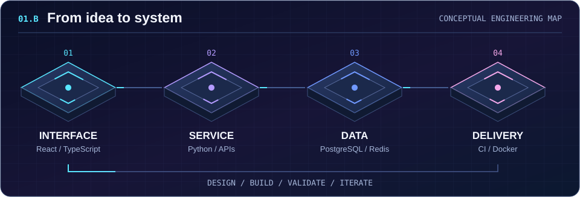

 

## About me

## Technology stack

## GitHub activity

Calendar and language data: 24 Nov 2026 snapshot. Streak and activity graph: live.

<picture>
  <source media="(prefers-color-scheme: dark)" srcset="https://streak-stats.demolab.com/?user=Muhammad-Bilal172&amp;background=0A1028&amp;stroke=2A3C67&amp;ring=58E6FF&amp;fire=B49BFF&amp;currStreakNum=F4F7FF&amp;sideNums=F4F7FF&amp;currStreakLabel=58E6FF&amp;sideLabels=A6B7DA&amp;dates=A6B7DA&amp;hide_border=true" />
  
</picture>

<picture>
  <source media="(prefers-color-scheme: dark)" srcset="https://github-readme-activity-graph.vercel.app/graph?username=Muhammad-Bilal172&amp;bg_color=0A1028&amp;color=A6B7DA&amp;line=58E6FF&amp;point=B49BFF&amp;area=true&amp;hide_border=true" />
  
</picture>

## Connect

