 

[About](#about-me) &nbsp; / &nbsp; [Technology](#technology-stack) &nbsp; / &nbsp; [Activity](#github-activity) &nbsp; / &nbsp; [Connect](#connect)

## About me

## Technology stack

51 technologies and concepts / accessible text index

- **Languages:** Python, TypeScript, JavaScript, SQL, HTML5, CSS3, Bash.
- **Backend:** Django, Django REST Framework, REST APIs, OpenAPI, JWT, WebSockets, Celery, RabbitMQ.
- **Frontend:** React, React Router, Vite, Tailwind CSS, TanStack Query, Zustand, Node.js, npm, i18next, Leaflet.
- **Data & infrastructure:** PostgreSQL, Redis, Docker, Docker Compose, Linux, Nginx, Git, GitHub, GitHub Actions.
- **Testing & integrations:** pytest, Playwright, Vitest, Testing Library, Prometheus, Sentry, Stripe, Pillow, JSON Schema.
- **AI & automation (active exploration):** OpenAI, AI Agents, LLMs, RAG, MCP, FastAPI, LangChain, n8n.

## GitHub activity

Custom activity and language graphics are dated GitHub API snapshots. The following streak and activity graph update through their respective services.

<picture>
  <source media="(prefers-color-scheme: dark)" srcset="https://streak-stats.demolab.com/?user=Muhammad-Bilal172&amp;background=0A1028&amp;stroke=2A3C67&amp;ring=58E6FF&amp;fire=B49BFF&amp;currStreakNum=F4F7FF&amp;sideNums=F4F7FF&amp;currStreakLabel=58E6FF&amp;sideLabels=A6B7DA&amp;dates=A6B7DA&amp;hide_border=true" />
  
</picture>

<picture>
  <source media="(prefers-color-scheme: dark)" srcset="https://github-readme-activity-graph.vercel.app/graph?username=Muhammad-Bilal172&amp;bg_color=0A1028&amp;color=A6B7DA&amp;line=58E6FF&amp;point=B49BFF&amp;area=true&amp;hide_border=true" />
  
</picture>

## Connect

MB / CHROMATIC SYSTEMS

