 

## About me

I focus on building reliable software, from backend services and modern web applications to AI-assisted engineering workflows. I value clear architecture, maintainable code and thoughtful automation.

| **Backend & architecture** | **Engineering & automation** |
| :--- | :--- |
| API design, authentication and real-time systems | CI/CD, testing and observability |
| Multi-tenant architecture and data isolation | Developer tooling and intelligent workflows |
| Databases, integrations and asynchronous processing | Exploring AI agents, LLMs and RAG |

## Technology stack

  <picture>
    <source media="(prefers-color-scheme: dark)" srcset="https://skillicons.dev/icons?i=python,django,ts,react,postgres,redis,docker,linux,git,githubactions&amp;theme=dark&amp;perline=10" />
    
  </picture>

 

<table>
<tr>
<td width="50%" valign="top">
  <h3>Languages &amp; foundations</h3>
  
  
  
  
  
  
  
</td>
<td width="50%" valign="top">
  <h3>Backend &amp; APIs</h3>
  
  
  
  
  
  
  
  
</td>
</tr>
<tr>
<td width="50%" valign="top">
  <h3>Frontend engineering</h3>
  
  
  
  
  
  
  
  
  
  
</td>
<td width="50%" valign="top">
  <h3>Data &amp; infrastructure</h3>
  
  
  
  
  
  
  
  
  
</td>
</tr>
<tr>
<td width="50%" valign="top">
  <h3>Testing &amp; observability</h3>
  
  
  
  
  
  
  
  
  
</td>
<td width="50%" valign="top">
  <h3>AI &amp; automation · exploring</h3>
  
  
  
  
  
  
  
  
</td>
</tr>
</table>

Technologies used in engineering work and areas of active exploration.

## GitHub activity

  <picture>
    <source media="(prefers-color-scheme: dark)" srcset="https://github-readme-stats.vercel.app/api?username=Muhammad-Bilal172&amp;show_icons=true&amp;include_all_commits=true&amp;theme=github_dark&amp;hide_border=true&amp;hide_rank=true&amp;title_color=58A6FF" />
    
  </picture>
  <picture>
    <source media="(prefers-color-scheme: dark)" srcset="https://github-readme-stats.vercel.app/api/top-langs/?username=Muhammad-Bilal172&amp;layout=compact&amp;langs_count=6&amp;theme=github_dark&amp;hide_border=true" />
    
  </picture>

  <picture>
    <source media="(prefers-color-scheme: dark)" srcset="https://streak-stats.demolab.com/?user=Muhammad-Bilal172&amp;theme=github-dark-blue&amp;hide_border=true" />
    
  </picture>

  <picture>
    <source media="(prefers-color-scheme: dark)" srcset="https://github-readme-activity-graph.vercel.app/graph?username=Muhammad-Bilal172&amp;bg_color=0d1117&amp;color=9ca3af&amp;line=38bdf8&amp;point=818cf8&amp;area=true&amp;hide_border=true" />
    
  </picture>

---

**Build thoughtfully. Learn continuously. Improve with every iteration.**

[View my GitHub activity](https://github.com/Muhammad-Bilal172#js-contribution-activity)

