 

## About me

## Technology stack

      

       

         

        

        

       

Technologies used in engineering work and areas of active exploration.

## GitHub activity

Overview and language distribution are dated snapshots from GitHub's API. The streak and contribution graph below update through their respective services.

  <picture>
    <source media="(prefers-color-scheme: dark)" srcset="https://streak-stats.demolab.com/?user=Muhammad-Bilal172&amp;theme=github-dark-blue&amp;hide_border=true" />
    
  </picture>

  <picture>
    <source media="(prefers-color-scheme: dark)" srcset="https://github-readme-activity-graph.vercel.app/graph?username=Muhammad-Bilal172&amp;bg_color=0d1117&amp;color=9ca3af&amp;line=38bdf8&amp;point=818cf8&amp;area=true&amp;hide_border=true" />
    
  </picture>

## Connect

